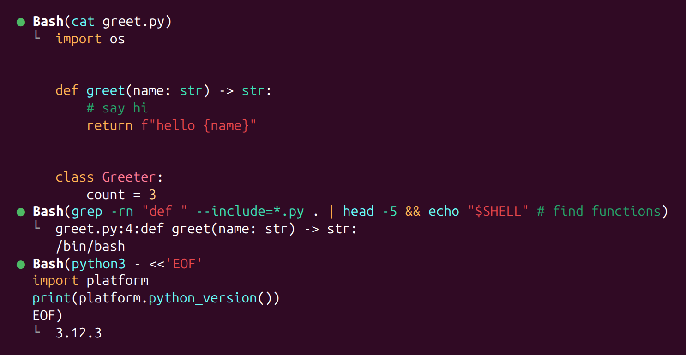
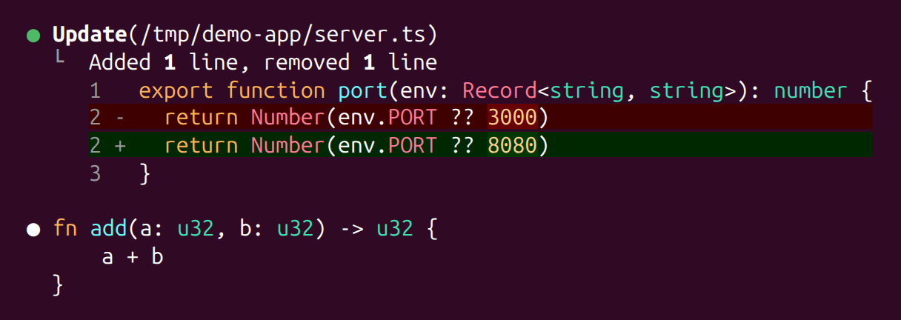
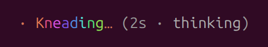
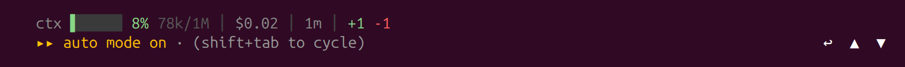

# claude-mods

Mods for Claude Code's own interface. Each folder is one mod.

| Mod | What it does |
| :- | :- |
| [`code-colors`](code-colors) | Syntax colors for code blocks, reply prose, Edit/Write diffs, Bash rows and Fetch results, with your own palette |
| [`jump-to-prompts`](jump-to-prompts) | ↩ ▲ ▼ buttons under the prompt box. ▲ ▼ scroll the conversation to your previous or next prompt, ↩ presses Enter in the prompt box |

## code-colors

Claude Code's token colors are fixed per theme. code-colors draws code with its own palette instead: code blocks in replies, Edit/Write diffs, Bash rows (the command, heredoc bodies, all output: printed code files and grep/rg results in each file's language, in chains too, diffs and JSON as such, anything else by its shape; the diff of files a command changed) and Fetch results (Markdown, front matter, JSON). Reply prose gets colors too: bold, inline code, links, headings, list markers and hex codes.





**Languages:** SQL, SurrealQL, TS/JS, Python, Rust, C family (C, C++, C#, Swift, GLSL), HCL, shell, PowerShell, Windows batch, HTML, CSS, JSON, YAML, TOML/INI, Markdown.

**Try it** for one session:

```sh
git clone https://github.com/duplonicus/claude-mods
claude --plugin-dir claude-mods/code-colors
```

**Keep it** the same way as any mod here: add its folder to `CLAUDE_CODE_PLUGIN_DIRS` (see jump-to-prompts below).



### How it behaves

- Palettes are constants at the top of `hooks/highlight.ts`, prose colors in `hooks/prose.ts`, diff tints in `hooks/diff.ts`.
- While a Bash row runs, its bullet turns like Claude Code's spinner glyph and `Bash(` `)` shimmer like the spinner's word, in the same colors; the command keeps its own.
- While Claude is thinking, the spinner's word is a rainbow that flows faster the faster the thinking streams in. The spinner's timer and token count stay Claude Code's. (The thinking rows in the transcript can't be drawn by a mod.)
- Bash rows are redrawn only when drawn in full (`"verbose": true`, or ctrl+o). Rows Claude Code adds its own parts to (background tasks, git commits, output saved to a file, output with terminal escapes) stay Claude Code's.
- Read rows aren't colored: Claude Code shows "Read N lines", never the file's text.
- Tables, quotes and fences in unknown languages stay as Claude Code draws them.

### Thanks

code-colors started from [Jason-Mendes's mod](https://github.com/anthropics/claude-code/issues/48636#issuecomment-5941847323) on the Claude Code issue asking for customizable code colors: the reply/diff split, the VS Code Dark Modern palette and the measured diff tints all come from there. Thanks, Jason.

## jump-to-prompts

In a long session, finding where you asked something means scrolling through every tool call since. ▲ jumps to the prompt before the one on screen, ▼ to the next one, and past your last prompt to the bottom. ↩ presses Enter in the prompt box, for when your hand is already on the mouse.



**Needs** fullscreen rendering, since that is where mouse clicks reach the UI. Set `"tui": "fullscreen"` in `~/.claude/settings.json`.

**Try it** for one session:

```sh
git clone https://github.com/duplonicus/claude-mods
claude --plugin-dir claude-mods/jump-to-prompts
```

**Keep it** in every session: add the folder to `CLAUDE_CODE_PLUGIN_DIRS` in the `env` block of `~/.claude/settings.json` (separate several paths with `:`), then restart Claude Code.

```json
"env": { "CLAUDE_CODE_PLUGIN_DIRS": "/path/to/claude-mods/jump-to-prompts" }
```

### How it behaves

- The buttons sit at the right end of the row under the prompt box, beside the status line when there is room. With [claude-statusline](https://github.com/duplonicus/claude-statusline), which saves its row widths for the mod to read, a window too narrow for that moves them to the right end of the permission-mode line; with any other status line, or when that line is full too, they go to a row of their own at the bottom.
- On the permission-mode line the mod draws the line itself while the buttons are on it, so its pills are plain text then. A mod isn't told the permission mode, so room is counted for the longest label: in modes other than bypass permissions the buttons sit a few cells short of the right end.
- What counts as a prompt: what you typed, including slash commands and prompts sent while Claude was working. Not: auto-run skills, task notifications, "Request interrupted" lines.
- A jump lands on the first row after the prompt, so fullscreen's sticky header shows the prompt you jumped to.
- Two clicks under about half a second apart on one button are a double-click: one jump, plus a text-selection highlight. That's Claude Code's selection; a mod can't turn it off.
- When you are scrolled up, fullscreen stops following new output. Press Ctrl+End to return to the bottom.
- On Windows (WSL included), ↩ presses a real Enter through PowerShell, about half a second after the click, into the focused window: switch windows in that half-second and the Enter lands there. Everything Enter does works: pastes, images, bash mode, joining a running turn.
- Elsewhere, from Remote Control, or if PowerShell fails, ↩ sends the draft itself: your text as your own words, slash commands as commands. Claude Code draws a "Prompt from the jump-to-prompts plugin" line above it, and a prompt sent while Claude is working waits for the turn to end instead of joining it. A big paste or an image is left for Enter with a toast (the box holds only a `[Pasted text #1]` placeholder), bash mode (`!`) goes to Claude as a prompt, and `@file` mentions go as plain text.
- `JUMP_TO_PROMPTS_DEBUG=<file> claude` writes one JSON line per press: what the mod thought was on screen and where it went.

### Not tested yet

After `/compact`, after a rewind, with Remote Control attached, with a last row taller than the window, and in Windows-native (non-WSL) sessions. Issues welcome.

## Development

```sh
claude plugin test <mod>      # runs hooks/*.test.ts
claude plugin validate <mod>  # checks it loads
```

Built on Claude Code 2.1.312; last run on 2.1.316.

## License

MIT
